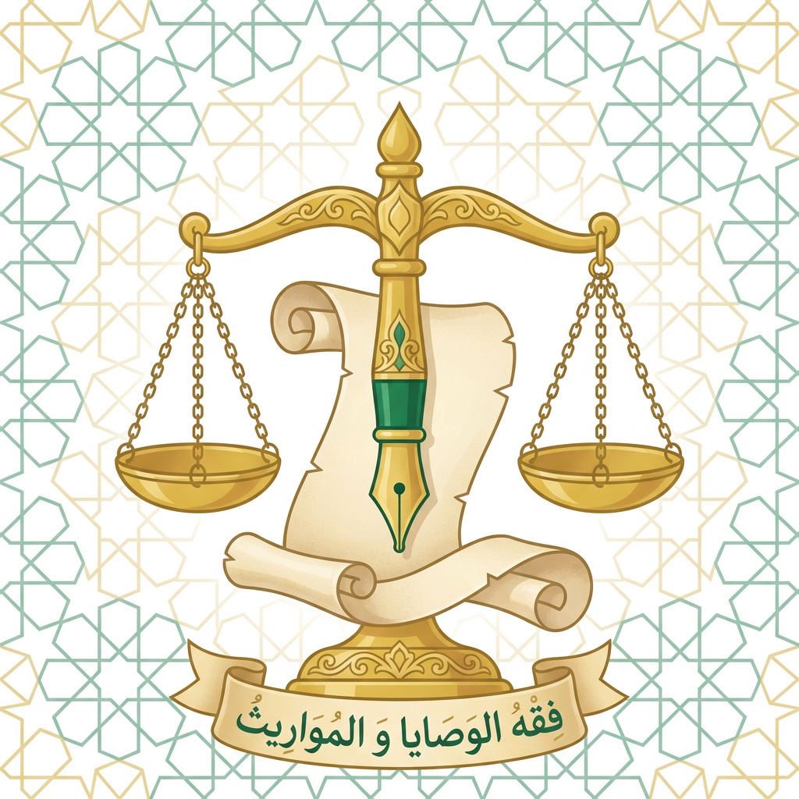

# فقه الوصايا والمواريث — مشروع رسوخ

تطبيق تعليمي وتطبيقي تفاعلي بالعربية (RTL) يغطّي محاور كتاب **إطلالات على فقه التركات** للأستاذ إبراهيم بن عمر بورورو، ويقدّمه الأستاذ ح قاسم بن ح عمر حاج امحمد ضمن **مدرسة أبي سالم تجنينت — مشروع رسوخ**.



## ما يشمله التطبيق

- **عشرة محاور مترابطة:** المدخل التصوري، مقاصد الوصية وأحكامها، الكفّارات، الحقوق والديون، الوكيل والأهلية، المواريث، تصفية التركات، التوبة والوصية الروحية، وصية الأقرب والأعراف، والخاتمة والمشاريع الخيرية.
- **مسار تكويني متدرّج** من الفهم إلى التطبيق، مع شهادة تخرّج رقمية.
- **أدوات تفاعلية:** صانع الوصية النموذجية، حاسبة تقسيم التركة، حاسبة الوصية النسبية، معجم المصطلحات، بحث سريع في كل المحاور، واختبار من ٢٥ سؤالاً بترتيب عشوائي.
- **عمل دون اتصال** بعد الزيارة الأولى بفضل service worker، مع إمكانية تثبيت التطبيق كـ PWA على الحاسوب والهاتف.

## الرابط

[افتح التطبيق على GitHub Pages](https://myapp47000-bio.github.io/wassaya-2026/)

## التشغيل محلياً

```powershell
.\serve.ps1
```

ثم افتح `http://localhost:8080/`.

أو استخدم أي خادم ثابت، مثل: `python -m http.server 8080`.

## بنية النشر

يجب رفع **المجلدات كاملة** لا الملفات المفردة فقط:

```text
index.html
manifest.json
sw.js
css/style.css
js/app.js
js/data.js
icons/*.png
```

أرشيف `deploy-complete.zip` يحتوي على هذه البنية جاهزة. أما `DEPLOY_SINGLE_FILE/index.html` فهو نسخة ملف واحد للاستخدام السريع إذا أردت رفع ملف واحد فقط، لكن دون كامل مزايا العمل دون اتصال.

بعد كل تحديث، انتظر دقيقة أو دقيقتين ثم افتح الرابط بـ `Ctrl+Shift+R` لتجاوز الكاش القديم.

## تنبيه شرعي

التطبيق **تعليمي** ولا يُصدر فتوى. مسائل المواريث والتركات تختلف بتفاصيلها، وينبغي الرجوع إلى عالم مختص قبل العمل بها.
